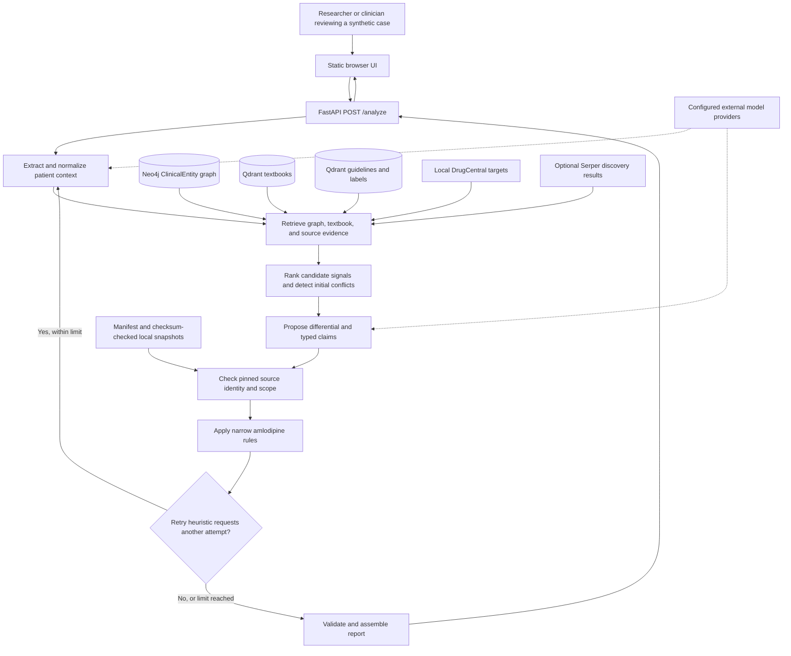

# 02 — Architecture and code map

[Documentation index](README.md) · [Previous: overview](01_PROJECT_OVERVIEW.md) · [Next: request flow](03_END_TO_END_REQUEST_FLOW.md)

## 1. System architecture

The retry arrow means re-extract the **original** case while keeping an expanded retrieval query. It does not mean add generated feedback to the patient history.

The Serper branch is collected by the orchestrator, but the current ranker and fusion prompt do not include its snippets as a separate evidence input. Treat it as collected discovery output, not a demonstrated influence on final synthesis.

## 2. Deployment shape

There is one Python API application, one static frontend, and two local database services. Model calls and optional search use external HTTP APIs. There is no separate frontend development server, task queue, agent cluster, or microservice per agent.

The default application server listens on port 8000. Neo4j uses Bolt port 7687 and browser port 7474. Qdrant uses HTTP port 6333; the helper also publishes port 6334. These are development defaults from the code and scripts.

## 3. Main source directories

| Path | Responsibility |
| --- | --- |
| [backend/main.py](../backend/main.py) | Build FastAPI app, attach routes, serve `/ui`, set frontend cache headers |
| [backend/config.py](../backend/config.py) | Settings and repository-root `.env` loading |
| [backend/api/routes.py](../backend/api/routes.py) | Initialize services and coordinate the complete analysis |
| [backend/agents/](../backend/agents/) | Extraction, evidence ranking, conflict checks, fusion, retry, report generation |
| [backend/services/](../backend/services/) | Ontologies, retrievers, provider adapter, source gate, fact extraction, timing |
| [backend/schemas/](../backend/schemas/) | Patient, evidence, retrieval, claim, and report data models |
| [frontend/](../frontend/) | Static form and report rendering |
| [ingestion/](../ingestion/) | Build graph and vector stores; prepare local models and sources |
| [sources/hypertension/manifest.json](../sources/hypertension/manifest.json) | Tracked source identities, sections, versions, and checksums |
| [evaluation/](../evaluation/) | Cases, runners, replay, metrics, review preparation, protocol freezes |
| [tests/](../tests/) | Most component and regression checks |
| [backend/tests/](../backend/tests/) | Additional API integration and schema tests |
| [paper/](../paper/) | Dated aggregate results, manuscript drafts, and research status records |
| [datasets/DATASET_GUIDE.md](../datasets/DATASET_GUIDE.md) | Inventory of separately obtained local data |
| [DATABASE_CHECKPOINT.md](../DATABASE_CHECKPOINT.md) | Historical database backup and rollback details |

`datasets/`, database volumes, `evaluation/runs/`, model files, and local backups are largely ignored by Git. A source checkout does not carry a working data environment.

## 4. Route and initialization

`get_pipeline()` in `routes.py` constructs the services on the first analysis request and stores them in the module-level `pipeline_state` dictionary. Later requests reuse those objects in that process.

This reduces repeated ontology loading and model initialization, but introduces shared mutable state. For example, provider trace attributes are stored on shared LLM objects. Lazy initialization is not protected by a lock. These are limitations for concurrent deployment, even though a local single-user demonstration may work.

The API request handler is a synchronous `def`. Its retrieval calls are sequential. Do not interpret the orchestrator's “fan-out” comment as implemented parallel execution.

## 5. Components in execution order

| Component | Input | Output and purpose |
| --- | --- | --- |
| `OntologyParser` | HPO, MONDO, drug-name files | Lookup table of normalized names and synonyms |
| `EntityLinker` | Extracted phrase and entity type | Best exact/fuzzy vocabulary match and candidates |
| `ClinicalClarifier` | Original case text | `PatientContext`, using LLM hints plus deterministic checks |
| `RetrievalOrchestrator` | Patient context | Separate graph, vector, DrugCentral, web, and source results |
| `EvidenceRanker` | Context and retrieval result | Sorted general `EvidenceItem` list |
| `ConflictDetector.detect` | Context, graph results, ranked evidence | Initial graph concerns and information gaps |
| `ClinicalFusion` | Context, evidence, conflicts, source passages | Ranked diagnoses and normalized claim proposals |
| `ClaimVerifier` | Claims and retrieved source passages | Unverified general claims, trusted passages, failures, counts |
| `ConflictDetector.detect_medication_safety` | Explicit facts, trusted passages, checked claims | Narrow label warnings and possible treatment conflict |
| `ConfidenceEvaluator` | Diagnoses, conflicts, missing information | Legacy score and retry/report action |
| `AdaptiveRetry` | Attempt number and context | Bounded retry decision and query expansion |
| `ReportGenerator` | Final context, candidates, claims, sources, counts | Validated `ClinicalReport` |

The gate is independent from model generation in the sense that separate code checks the proposals. It is not an independent clinician, research evaluator, or second LLM.

## 6. Service-level code map

| File | Important behavior |
| --- | --- |
| [ontology_parser.py](../backend/services/ontology_parser.py) | Parse OBO terms, ignore obsolete terms, add synonyms and drug names |
| [entity_linker.py](../backend/services/entity_linker.py) | Normalize punctuation/case; restrict matches to HPO, MONDO, or DRUG |
| [patient_fact_extractor.py](../backend/services/patient_fact_extractor.py) | Anchor safety facts to actual input phrases; retain unknown/conflicting states |
| [graph_retriever.py](../backend/services/graph_retriever.py) | Query bounded phenotype–disease candidates and drug contraindication associations |
| [vector_retriever.py](../backend/services/vector_retriever.py) | Dense search, optional local reranking, scoped authoritative retrieval |
| [drugcentral.py](../backend/services/drugcentral.py) | Load local drug–target rows and find targets by drug name |
| [evidence_scanner.py](../backend/services/evidence_scanner.py) | Optional Serper discovery query |
| [llm_fallback.py](../backend/services/llm_fallback.py) | Provider order, request transport, JSON parsing, validation, response trace |
| [claim_synthesis.py](../backend/services/claim_synthesis.py) | Validate proposals, normalize citation buckets, assign stable claim IDs |
| [claim_verifier.py](../backend/services/claim_verifier.py) | Compare retrieved source objects with locally rebuilt pinned passages |
| [telemetry.py](../backend/services/telemetry.py) | Context-local timing capture used by evaluation |
| [document_chunker.py](../backend/services/document_chunker.py) | General chunking helper; not the active textbook importer's chunking function |

The active textbook chunker is `ingestion.populate_qdrant.chunk_text`. Knowing which helper is actually called avoids documenting unused code as runtime behavior.

## 7. Data contracts

### Patient data

[patient.py](../backend/schemas/patient.py) defines `LinkedEntity`, `MedicationStatement`, `BloodPressureReading`, and `PatientContext`.

`PatientContext` retains original text, optional query expansion, demographics, linked entities, medication history, explicit status fields, measurements, selected labs, missing facts, and flags. It preserves the difference between “not supplied” and “explicitly absent.”

### Retrieval data

[retrieval.py](../backend/schemas/retrieval.py) defines `GraphPath`, `GraphRetrievalResult`, `VectorRetrievalResult`, and `OrchestratorResult`. Keeping separate fields stops a textbook match or graph association from silently becoming a pinned citation.

### Evidence and claims

[evidence.py](../backend/schemas/evidence.py) defines general `EvidenceItem` objects and traceable `SourcePassage` objects. The latter include a document identity, version, date, section, passage span, and stable ID.

[report.py](../backend/schemas/report.py) defines `ClinicalClaim`, `DiagnosisCandidate`, `DifferentialEntry`, `MedicationSafetySummary`, and `ClinicalReport`. Report validation checks source resolution, unique IDs, and correctly typed claim group references.

## 8. Boundaries that matter

| Boundary | What crosses it | Why it matters |
| --- | --- | --- |
| Browser → API | Case text | No authentication or request length limit is implemented |
| API → providers | Case content and constructed prompts | Local databases do not make inference fully offline |
| API → Neo4j/Qdrant | Names, identifiers, query vectors | Data/model versions affect retrieval |
| API → Serper | Symptom/condition search terms | Optional external disclosure and availability |
| Retrieval → gate | Claimed source metadata and text | Stored payloads must match local pinned passages |
| Gate → report | Checked claims and explicit failures | Source identity must not be presented as full clinical truth |
| Evaluation → review | Blinded claims and cited passages | Reviewers must not receive the private mode/status mapping |

## 9. Architectural choices to remember

The project favors explicit typed data and readable stages over a complex orchestration framework. Graph and vector databases serve different retrieval needs. A separate deterministic gate prevents a model from declaring its own general proposals verified. The report keeps legacy fields for compatibility while giving the UI richer claim-level structures.

The costs are operational complexity, multiple data stores, shared process state, several external providers, and incomplete verification coverage. These are concrete tradeoffs to discuss during a design review.
