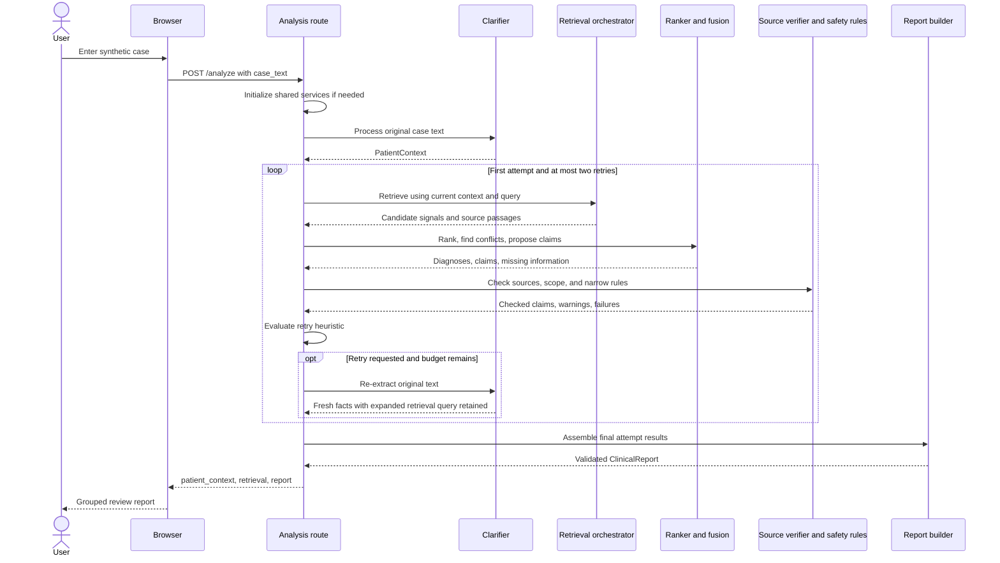

# 03 — End-to-end request flow

[Documentation index](README.md) · [Previous: architecture](02_ARCHITECTURE_AND_CODE_MAP.md) · [Next: data and retrieval](04_DATA_INGESTION_AND_RETRIEVAL.md)

## 1. Example input

Use this synthetic case to follow the software:

> A 57-year-old woman with confirmed hypertension currently takes amlodipine and simvastatin. She has no known drug allergies. Clinic BP 152/94.

This example is for tracing extraction and warning logic. It is not medical guidance. A particular model output or warning is not guaranteed: source availability, retrieval, extraction, and provider responses all affect the report.

## 2. Complete sequence



The loop stops early when the retry helper returns false. It always stops after the configured retry budget, even if the final heuristic remains low.

## 3. The browser submits the case

`frontend/app.js` listens for the form's submit event, trims the text, and ignores an empty input. It disables the button, shows a loading state, hides old results, and sends:

```json
{"case_text":"A 57-year-old woman with confirmed hypertension currently takes amlodipine and simvastatin. She has no known drug allergies. Clinic BP 152/94."}
```

The request goes to `/analyze` on the same origin as the UI. There is no browser-side streaming or progress polling.

## 4. FastAPI validates the request structure

`AnalyzeRequest` requires `case_text` to be a string. It does not add a nonblank validator or maximum length. A missing required field or invalid type gets normal FastAPI/Pydantic request validation. An empty string is structurally valid at the API even though the UI blocks it.

`get_pipeline()` initializes service objects when `pipeline_state` is empty. Initialization parses local vocabularies, creates the Neo4j driver, attempts to load local embedding/reranking models, loads DrugCentral data, and constructs the processing components.

## 5. The clarifier builds patient context

The clarifier asks the first working configured provider to extract JSON lists such as symptoms, known conditions, medicine names, and quoted statements. It validates list shapes, then passes the original case and those hints to `extract_safety_facts`.

For the example, successful deterministic parsing should identify these facts:

| Field | Expected interpretation |
| --- | --- |
| Age | 57, from the age phrase |
| Sex | female, from “woman” |
| Hypertension confirmation | true, from “confirmed hypertension” |
| Medicine statements | amlodipine and simvastatin, stated as current |
| Medication-list status | reported |
| Allergy status | no_known_allergies |
| Blood pressure | 152/94, clinic setting |
| Renal function and potassium | not supplied |
| Pregnancy status | unknown |

The model may extract additional symptoms or conditions; those lists are not all validated by the same strict anchoring rules as medicines and allergies. Extraction remains fallible.

The linker then searches the appropriate vocabulary: HPO for symptoms, MONDO for conditions, DRUG for medicines and allergens. An unmatched phrase is retained without an ontology ID.

## 6. Retrieval runs in separate branches

The orchestrator executes the following calls in order:

1. Graph retrieval using linked symptom names/IDs and current medicines.
2. Textbook vector retrieval using the case or expanded query.
3. Scoped guideline/label retrieval.
4. DrugCentral target lookup for current medicines.
5. Optional Serper search when a key and extracted query terms are present.

The example names hypertension, amlodipine, and simvastatin, so it passes the authoritative-source scope filter. The retriever still needs cached models, both configured collections, and matching local snapshots.

A case with no linked symptoms may have no graph disease candidates. That can be expected, not proof that the graph is broken. Drug lookups can still find contraindication associations, although the initial conflict detector only flags those that overlap graph disease candidates.

## 7. General evidence is ranked

`EvidenceRanker` builds general retrieval items from graph candidates, textbook hits, and DrugCentral targets. It scores and sorts them heuristically.

These items have temporary UUIDs. They are candidate context, not permitted authoritative claim citations. Authoritative `SourcePassage` records travel separately to fusion and verification.

The initial conflict detector adds possible graph contraindications, any supplied graph interactions, and incomplete-demographic flags. Current graph retrieval returns an empty drug-interaction list; the schema and detector support such items without implementing a general interaction database.

## 8. Fusion asks for structured proposals

`ClinicalFusion` builds a prompt from patient facts, conflicts, selected general evidence, and up to 12 authoritative passages. General candidate evidence has a shared word budget of 1,600 words, with up to three graph items and five other items, capped at 350 words each.

The expected response has five required lists:

```text
diagnoses
diagnostic_claims
investigations_to_consider
treatment_options_if_confirmed
missing_information
```

The model is told to use only the supplied authoritative source IDs as citations. Treatment proposals must name their applicable condition and have explicit conditions. The proposal validator rejects certain imperative openings such as “Start” and “Prescribe.” This is a narrow format safeguard, not a general clinical language validator.

For Gemini synthesis, the schema is also sent in the provider request. Client-side validation remains necessary because JSON syntax alone cannot establish the response's structure or clinical correctness.

## 9. Claim normalization removes invalid citation roles

`normalize_claims` converts proposals into `ClinicalClaim` objects. It:

- Accepts citation IDs only from available citable source passages.
- Records unavailable or non-authoritative IDs in `rejected_evidence_ids`.
- Deduplicates each evidence list.
- Moves a passage assigned incompatible roles into the unverified bucket.
- Adds diagnosis confirmation and context missing facts to treatment requirements.
- Creates a stable claim ID from the normalized content.
- Starts every generated claim as `unverified`.

The model cannot promote a proposal to `supported` by returning a status field.

## 10. The independent gate checks sources and scope

The verifier rebuilds pinned passages from checksum-checked local documents. A retrieved source is trusted only if its ID and full source object match a locally pinned passage and its type is guideline or drug label.

It checks cited IDs, rejected IDs, treatment prerequisites, relevant patient states, and several narrow document/scope mismatches. It then leaves **every general generated claim unverified**, because broad meaning and patient applicability are not automatically established.

A claim may have a real candidate supporting citation and still need clinical review. A source count is not a support score.

## 11. Label rules add narrow findings

The medication detector examines the checked claims and trusted passages. Amlodipine is relevant if it appears in explicit current medication statements or a proposed treatment claim.

For this example, current simvastatin can trigger an interaction/dose-review warning **if the exact pinned interaction passage was retrieved and trusted**. Without the passage, the concern remains unverified.

If allergy or current-medication status is unknown or conflicting, the detector produces an uncertainty finding. If an explicit amlodipine allergy and the correct contraindication passage are present, it can produce a supported warning and change an amlodipine treatment proposal to `conflicting`.

## 12. The retry heuristic makes a bounded decision

The legacy score starts with the first diagnosis score and subtracts penalties:

```text
score = clamp(top diagnosis confidence
              - 0.15 × number of high-severity conflicts
              - 0.05 × number of missing-information entries,
              0, 1)
```

| Score | Action |
| --- | --- |
| At least 0.65 | report |
| At least 0.45 and below 0.65 | report_with_limitations |
| Below 0.45, or no diagnoses | retry |

The route creates `AdaptiveRetry(max_retries=2)`, allowing one initial attempt plus two retries. The class's standalone default is three retries, but the route overrides it.

A retry appends available symptom candidate names to the retrieval query and includes conflict feedback. Patient facts are extracted again from the original case. A retry cannot obtain a missing lab or allergy history from the user; it can only search and generate again. The final report uses the final attempt, rather than merging all attempts.

The value is an uncalibrated control heuristic. Repeated low scores do not prove an emergency, and a high score does not establish a correct diagnosis.

## 13. Report assembly and rendering

The report builder summarizes extracted facts, groups claims by type, links matching condition names to differential entries, collects medication findings, and includes missing information and limitations. Its condition grouping uses case-insensitive exact names, not a semantic synonym resolver.

`ClinicalReport` validates unique IDs and references before the API serializes the result. The UI builds claim/source lookup maps and renders separate sections. It uses text nodes for generated text and allows clickable citation URLs only for HTTPS NICE and DailyMed hosts.

## 14. What happens when components fail?

| Failure | Current behavior |
| --- | --- |
| No provider returns valid extraction JSON | Use limited deterministic extraction and empty generic lists |
| No provider returns valid synthesis JSON | Return a zero-score synthesis-unavailable candidate and unverified graph candidate claims |
| Vector initialization/search fails | Return empty textbook results; authoritative retrieval records limitations |
| Source snapshot is missing or changed | Source trust is unavailable; claims remain unverified |
| Expected label section was not retrieved | No supported label warning for that rule |
| Neo4j query raises an exception | It can propagate and fail the request; there is no complete graph-outage fallback |
| Report contract fails validation | The route can fail; the UI shows a request error |
| UI rendering throws | Hide results and show a refresh/retry message |

Some failures degrade gracefully and others stop the request. “Fallback exists” should not be described as “the whole application always works offline.”
