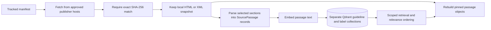

# 04 — Data, ingestion, and retrieval

[Documentation index](README.md) · [Previous: request flow](03_END_TO_END_REQUEST_FLOW.md) · [Next: verification and safety](05_CLAIMS_VERIFICATION_AND_SAFETY.md)

## 1. Data inventory and purpose

| Input | Local path or store | Purpose |
| --- | --- | --- |
| HPO ontology | `datasets/ontologies/hpo/hp.obo` | Symptom/phenotype names, synonyms, IDs |
| MONDO ontology | `datasets/ontologies/mondo/mondo.obo` | Disease names, synonyms, IDs |
| DrugCentral drug names | `datasets/drugcentral/structures.smiles.tsv` | Drug/allergen linking vocabulary |
| DrugCentral targets | `datasets/drugcentral/drug.target.interaction.tsv.gz` or uncompressed `.tsv` | Drug–target lookup |
| PrimeKG CSV | `datasets/kg.csv` | Selected clinical relationships for Neo4j |
| First Aid and Pathoma text | `datasets/literature/MedQA/MedQA-USMLE/textbooks/en/` | Default selected textbook retrieval corpus |
| NICE HTML and DailyMed XML | `datasets/authoritative/hypertension/` | Exact local source snapshots |
| Source manifest | `sources/hypertension/manifest.json` | Versions, sections, jurisdictions, checksums |
| Evaluation cases and labels | `evaluation/` and ignored run directories | Scoring; excluded from ingestion |

The runtime does not train on MedQA questions. The active importer admits text files only from the designated textbook directory. MedQA exam questions are used by separate evaluation adapters. PubMedQA, MedMCQA, and MedBullets paths in settings do not mean those datasets are all loaded by `/analyze`.

Publisher acquisition links and local filenames are listed in [the dataset guide](../datasets/DATASET_GUIDE.md). Large datasets, raw snapshots, models, and database contents are not included in Git.

## 2. Ontology parsing and linking

`OntologyParser` reads OBO term blocks, records names and synonyms, filters obsolete terms, and adds drug names from a TSV. It builds a normalized-text lookup table.

Normalization lowercases text, removes punctuation, and collapses whitespace. `EntityLinker` selects a vocabulary based on entity type, then tries an exact match. If that fails, it uses RapidFuzz `WRatio` with a default threshold of 85 and up to five fuzzy name matches. The best accepted name supplies its candidates; the first candidate supplies the selected concept.

This is lexical normalization, not semantic diagnosis. A linker confidence of 1.0 means an exact vocabulary match, not certainty about the patient's disease. Ambiguous names, abbreviations, and missing vocabulary still cause errors.

## 3. Building the Neo4j graph

[populate_neo4j.py](../ingestion/populate_neo4j.py) reads the entire configured CSV in chunks of 100,000 rows. It selects four relation types:

| CSV relation | Stored relationship |
| --- | --- |
| `disease_phenotype_positive` | `PHENOTYPE_SUPPORTS_DISEASE` |
| `disease_phenotype_negative` | `PHENOTYPE_ABSENT_IN_DISEASE` |
| `contraindication` | `DRUG_CONTRAINDICATED_FOR` |
| `indication` | `DRUG_INDICATED_FOR` |

The importer requires `relation` and each endpoint's `index`, `id`, `type`, `name`, and `source` columns. It does not import every PrimeKG relation.

### Node identity

Each node has the label `ClinicalEntity` and properties including `uid`, `node_index`, `id`, `ontology_id`, `source`, `name`, and `type`.

The unique key is `PrimeKG:<global node index>`. Raw IDs from different vocabularies can overlap, so using a raw ID alone could incorrectly merge unrelated nodes. HPO numeric IDs are normalized to the `HP:0000000` form. Names are stored lowercase.

### Edge direction and duplicate handling

Edges are canonicalized to point from phenotype to disease or drug to disease. Reverse input rows therefore map to the same direction. The importer deduplicates pairs within each batch and uses Neo4j `MERGE` to avoid repeated stored edges across batches or reruns.

It creates a uniqueness constraint on `uid` and indexes on `name` and `ontology_id`, waits for indexes, and writes transaction batches of 2,000 records. It adds the new schema without deleting legacy nodes. It can update existing `ClinicalEntity` properties; “non-destructive” does not mean the database is never changed.

The output manifest records the CSV hash, schema version, processed selected rows, and actual stored relationship counts. Processed-row totals can differ from stored-edge totals because duplicates can appear across chunks.

### Runtime query

The graph retriever matches the case's symptom names or HPO IDs against phenotype nodes. For each disease it counts distinct matched positive and negative phenotype associations:

```text
candidate score = positive association count - negative association count
```

It requires at least one positive association and returns at most ten diseases, ordered by net score, positive count, then name. It also returns signed paths. Separately, it queries up to 100 drug contraindication associations for current medicine names.

The query uses explicit bounded associations, not probabilistic inference. An imported indication edge is available in the graph but is not used by the current retriever to choose treatments. A negative graph association is also not a general parser for negated symptoms in patient text.

## 4. Building the textbook collection

[populate_qdrant.py](../ingestion/populate_qdrant.py) defaults to complete `First_Aid_Step1.txt` and `Pathoma_Husain.txt`. It splits on whitespace into **150-word chunks with 20-word overlap**, giving a step of 130 words.

For a 1,000-word example, chunk starts are 0, 130, 260, and so on; the final chunk preserves the document's end. The overlap helps retain context across boundaries but also creates correlated passages. This chunker does not guarantee sentence boundaries.

Each point has a deterministic UUID derived from filename, file checksum, and chunk index. Its payload contains text, source name, document checksum, chunk index, and `corpus_kind=textbook`.

The importer uses the pinned biomedical encoder, 768-dimensional vectors, cosine distance, and batches of 32. It refuses an existing collection and refuses an existing manifest path. It checks the final point count against the number of generated chunks.

The active default collection is `medical_textbooks_v2`. `--files` selects named textbook files; `--all-textbooks` selects all `.txt` files in the allowed directory. Neither option authorizes question/answer ingestion.

## 5. Models and retrieval

| Role | Repository configuration |
| --- | --- |
| Encoder | `pritamdeka/S-PubMedBert-MS-MARCO` |
| Encoder revision | `96786c7024f95c5aac7f2b9a18086c7b97b23036` |
| Reranker | `cross-encoder/ms-marco-MiniLM-L-6-v2` |
| Reranker revision | `233902d25c440f23af6f7d6e94d2946bac0bee0a` |

These are the configured identifiers, not a claim about current upstream availability. [prepare_models.py](../ingestion/prepare_models.py) downloads the selected revisions before runtime. Runtime loading uses `local_files_only=True`.

The textbook retriever embeds the original or expanded case plus symptom text, requests at least 20 dense candidates, optionally reranks them, and returns five by default. The reranker evaluates query–passage pairs. Its raw score is converted with a sigmoid for the textbook item's score; this does not make it a clinical probability.

If the reranker is absent, supported local loading failures fall back to dense order. If vector initialization or search fails, textbook retrieval returns no items. A nonempty response does not prove the retrieved passages are relevant.

## 6. Pinned authoritative source lifecycle



`fetch` follows only approved official hosts and writes a document only if its bytes match the manifest checksum. `verify` checks local bytes and parses the selected sections. The DailyMed parser also checks SPL set ID, version number, and effective date.

The manifest selects 17 NICE recommendations. Saved snapshots report nine parsed label chunks, producing a 26-passage corpus for those snapshots. The number of label chunks is a parsing result, not merely the number of top-level selected label sections.

Source passage spans refer to normalized extracted section text, not raw HTML byte positions or PDF page coordinates. NICE recommendations are separate section passages with a start of zero. Larger DailyMed sections can be split around sentence boundaries.

**Important operational difference:** authoritative `ingest` replaces existing configured guideline/label collections after validating snapshots. It is not a non-overwriting import like the textbook script. Back up or point settings at new dedicated collection names before a source rebuild that must preserve old indexes.

## 7. Scoped authoritative retrieval

The scope check examines the original case for hypertension/high-blood-pressure, amlodipine, or simvastatin terms, or an extracted blood pressure at or above the code's routing threshold. These thresholds route retrieval; they do not implement a complete diagnostic rule.

A normal BP reading in an unrelated case does not automatically request this corpus. When in scope, the retriever:

1. Loads the manifest and checksum-verifies local snapshots.
2. Builds the set of valid pinned passage IDs.
3. Embeds the query.
4. Requests five hits from each active source-type collection by default.
5. Validates each payload's `SourcePassage`, document version, source checksum, type, and membership in the pinned ID set.
6. Merges passages by cross-encoder relevance, or by dense scores if no reranker is available.
7. Returns passages plus explicit collection/payload limitations.

It does not always return ten passages: scope, errors, available documents, and invalid payloads affect the count. The current code globally orders the merged hits; the older “guidelines first, labels second” ordering belongs to historical runs.

## 8. DrugCentral and web discovery

DrugCentral provides drug–target associations, not a comprehensive interaction or contraindication engine. The service uses exact lowercased drug-name matches and returns target name/class/gene/action information.

Serper requests up to three organic results using symptom and condition search terms. The orchestrator stores them separately. The current ranker does not turn them into `EvidenceItem` records, and the fusion prompt does not add their snippet text. They cannot become verified citations through this path.

## 9. Data separation and reproduction

Do not index evaluation cases, answer keys, reviewer labels, or exam answer explanations. The historical `medical_literature` collection was excluded after inspection found 384-dimensional embeddings and question/answer material; it is not a drop-in replacement for the 768-dimensional clean textbook collection.

For reproduction, retain the exact input hashes, model revisions, collection configuration, source snapshots, code revision, and run output. A fixed seed alone cannot freeze an external model alias or eliminate public-test training contamination.

The import and evaluation tools record different manifests for different purposes. Keep them together when reporting a result. A Git commit identifies source code; it does not by itself identify the live contents of a database.
