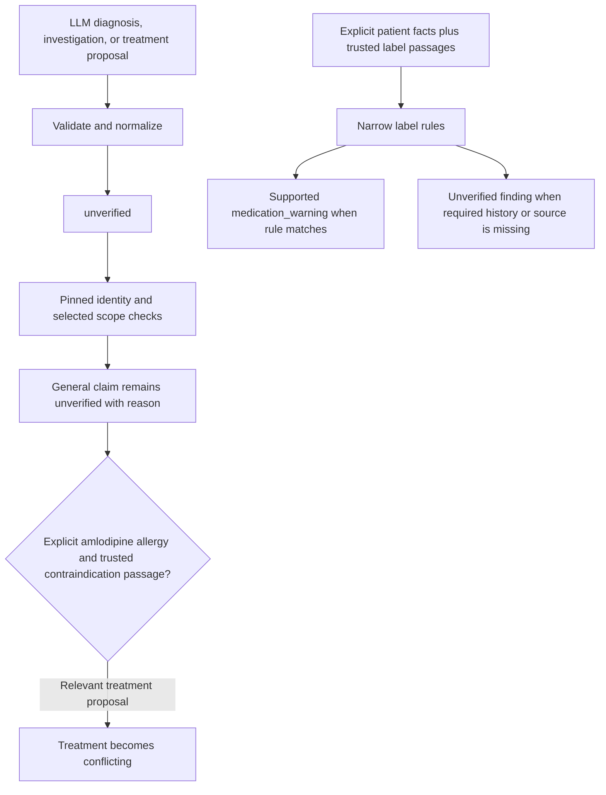

# 05 — Claims, verification, and safety

[Documentation index](README.md) · [Previous: data and retrieval](04_DATA_INGESTION_AND_RETRIEVAL.md) · [Next: setup and operations](06_SETUP_CONFIGURATION_AND_OPERATIONS.md)

## 1. Three different questions

The source gate separates questions that are often confused:

1. **Identity:** Is this the exact pinned source passage?
2. **Meaning:** Does that passage support the claim?
3. **Applicability:** Does the support fit this patient's facts and clinical setting?

The project implements strong checks for the first question within its local trust model, selected mismatch checks for the others, and two explicit label rules. It does not implement a general semantic-entailment or patient-eligibility engine.

## 2. Candidate evidence versus citable passages

| Object | Identity | Role |
| --- | --- | --- |
| `EvidenceItem` | Usually a runtime UUID | General graph, textbook, or DrugCentral context |
| `SourcePassage` | Stable content-derived `src_...` ID | Exact versioned document passage |
| `ClinicalClaim` | Stable normalized-content `claim_...` ID | One proposed statement with evidence roles and status |

Claim normalization accepts guideline, drug-label, or study passage IDs from available sources. The current manifest and production verifier only trust the implemented guideline and drug-label source types. A schema's ability to represent a study does not mean study ingestion and verification are implemented.

## 3. SourcePassage identity

A passage records publisher, document ID/version, title, dates, URL, jurisdiction, section, span, and text. Its ID is derived from a serialized identity containing:

```text
publisher
document_id
document_version
section
span_start and span_end
SHA-256 of passage text
```

The identity's SHA-256 is truncated to 24 hexadecimal characters and prefixed with `src_`. A provided ID must match the computed value. The model validates nonblank metadata, valid spans, and required URL/date fields for relevant source types.

Some metadata, including URL and jurisdiction, is not itself part of that ID recipe. This is why the verifier compares the **full retrieved source object** with the pinned object, rather than relying on the ID alone.

SHA-256 detects changes relative to trusted local metadata. It does not establish publisher correctness, source freshness, or the security of a compromised local manifest. Source review and manifest integrity still matter.

## 4. Claim structure

| Field | Meaning |
| --- | --- |
| `claim_id` | Stable identifier within normalized claim content |
| `claim_type` | diagnosis, investigation, treatment, or medication_warning |
| `text` | The proposed statement |
| `applies_to` | Named condition or exposure |
| `conditions` | Prerequisites that must hold |
| `missing_checks` | Facts/checks not yet established |
| `supporting_evidence_ids` | Proposed supporting source roles |
| `conflicting_evidence_ids` | Proposed conflicting source roles |
| `unverified_evidence_ids` | Sources whose role needs review |
| `rejected_evidence_ids` | Invalid or unavailable citation attempts retained for inspection |
| `status` | supported, conflicting, or unverified |
| `unverified_reason` | Explanation required for unverified claims |

The presence of `supporting_evidence_ids` does not override `status=unverified`. A proposed source role is not a completed verification judgment.

## 5. Status lifecycle



The gate resets general claims to unverified even if a caller supplied an optimistic status. The medication detector runs afterward and can create the narrow warning outcomes shown above.

## 6. What the verifier checks

[ClaimVerifier.verify](../backend/services/claim_verifier.py) loads pinned passages, builds a trusted retrieved subset, and checks each proposal for invalid IDs, missing citations, rejected IDs, and selected applicability concerns.

For treatment proposals, it checks missing prerequisites, unknown/conflicting allergy history, unknown/conflicting current medication list, and unconfirmed hypertension within hypertension scope.

Selected source mismatch checks include:

- An adult NICE passage supplied for a known child.
- NICE hypertension treatment passages supplied for pregnancy treatment.
- A hypertension passage attached to a different stated condition.
- A treatment section used to establish a diagnosis or investigation.
- The selected step-1 recommendation when age is unknown or type 2 diabetes is stated.
- A drug label used to establish a diagnosis.
- An amlodipine passage used for another condition or a simvastatin/allergy statement absent from that passage.

These are explicit checks, not a complete medical guideline implementation. After them, the verifier always adds that meaning, population, intervention, outcome, and jurisdiction require clinician review.

## 7. Explicit facts and unknown states

The extractor does not treat omitted history as a normal finding:

| Example statement | Stored state |
| --- | --- |
| No allergy information | `allergy_status=unknown` |
| “No known drug allergies” | `allergy_status=no_known_allergies` |
| “Allergic to amlodipine” | `allergy_status=allergies_reported` with a source phrase |
| Both positive allergy and no-known-allergy statements | `allergy_status=conflicting` |
| No current-medicine information | `medication_list_status=unknown` |
| “No current medications” | `medication_list_status=none_reported` |
| Explicit current medicine | `medication_list_status=reported` |
| Current and stopped statements for the same medicine | conflicting history requiring reconciliation |

Quoted LLM medicine/allergy hints must appear in the original case and satisfy cue checks. The extractor also uses deterministic patterns for blood pressure, selected labs, pregnancy, and hypertension confirmation.

This conservative policy has limits. Negation and time expressions are handled by a limited set of patterns. The symptom path has simple keyword fallback for “chest pain” and “shortness of breath,” without a complete negation parser. A copied phrase can still be misunderstood.

## 8. Rule A: reported amlodipine allergy

The rule needs amlodipine relevance, reported allergy status, an explicitly extracted amlodipine allergy, and a trusted passage from the exact configured SPL document's contraindication section. The source passage must contain the expected label concepts.

When those requirements hold, it creates a supported `amlodipine_allergy` finding and medication-warning claim. Relevant amlodipine treatment proposals become `conflicting`, with the contraindication passage in the conflicting evidence list.

If the patient fact is present but the exact passage is missing, the finding is unverified and the treatment stays unverified with a source-gap explanation. Unknown/conflicting allergy history generates `allergy_status_unconfirmed`, not a clearance.

## 9. Rule B: current simvastatin with amlodipine relevance

The rule uses explicit current medication statements and a known, nonconflicting current-medication-list status. It looks for simvastatin when amlodipine is current or proposed. It requires the trusted label's selected interaction section and expected text, including the code's label-dose phrase.

When the passage is available, it creates a supported `amlodipine_simvastatin` review warning. The warning asks for dose and interaction review; it does not prescribe a dose or determine actual patient dosing. Missing source support produces an unverified finding. Unknown/conflicting current medicines produce `medication_list_unconfirmed` instead.

These rules do not implement all amlodipine risks, all drugs, or all interactions. A history of “no known allergies” is not a complete safety clearance.

## 10. Report-level guarantees and their limits

The report schema checks that source IDs are unique, claim IDs are unique, active citation IDs resolve to included passages, and claim-group references resolve to the correct claim types. Supported claims need supporting IDs; conflicting claims need conflicting IDs; unverified claims need a reason. Supported medication findings need a source reference.

These are structural guarantees. They do not prove the text is medically correct. The report includes all retrieved source passages, while the safety rules operate only on the trusted subset. A source appearing in the report therefore does not automatically mean every linked proposal passed clinical verification.

## 11. Completeness counters

The API records claim counts, trusted pinned-passage availability, validated citation counts, invalid citation counts, and final status counts. Validated/invalid citation counts use distinct cited IDs rather than counting every repeated citation use. The route updates status totals after adding safety claims.

A large number of citations or supported warnings is not a calibrated measure of evidence quality. General semantic support is intentionally unresolved. Evaluate identity integrity, warning precision/recall, useful supported coverage, and patient applicability separately.

## 12. Fail-closed behavior

Here, “fail closed” means missing or changed evidence does not become a supported clinical claim. It does not mean all runtime exceptions are caught, or that a server outage always returns a graceful report.

The local trust model depends on correct source selection, protected manifests, retained snapshots, accurate extraction, retrieved relevant sections, and narrow rule applicability. Independent clinical review remains necessary to test whether the overall behavior is useful and appropriate.
