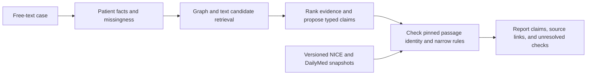

# Evidence-linked Graph-RAG for clinician review of differential and conditional treatment claims: architecture and a synthetic feasibility evaluation

**Manuscript status:** Research methods and engineering feasibility draft, 11 October 2026. Author names, affiliations, contributions, funding, and competing-interest declarations must be completed by the actual contributors before submission. The software has not been clinically validated.

## Abstract

**Background:** A clinical decision support report can look well sourced even when its citations merely point to related text. A useful research question is whether a retrieval-based prototype can expose the provenance and verification state of each proposed diagnosis, investigation, treatment option, and medication warning for clinician review. **Methods:** We implemented a local Graph-RAG pipeline that extracts facts from a free-text case, retrieves graph and text candidates, proposes structured claims, and checks cited passages against versioned guideline and drug-label snapshots. The verification gate reserves `supported` for narrowly specified, rule-checked label warnings; other proposals remain `unverified` when source identity or patient applicability is insufficient. We ran six hand-authored synthetic cases in three retrieval modes: language model only, text retrieval, and graph plus text retrieval. **Results:** All 18 case–mode runs completed. Exact alias matching to diagnoses already stated in the case text yielded top-1 counts of 1/6, 4/6, and 5/6, respectively. All 13 text-mode and 17 graph-plus-text citation uses matched the pinned passage identity; this does not establish clinical correctness. Expected warning types appeared in 2/3 labeled cases in each mode, and the unknown-allergy case was missed in all modes. Synthesis-provider fallback differed or was unknown across modes for three cases, so the retrieval comparison is confounded. No claims or treatment options have been independently clinician adjudicated. **Conclusion:** The prototype demonstrates an inspectable claim and provenance workflow in a restricted adult-hypertension source domain. Its synthetic results do not establish diagnostic accuracy, prescribing safety, calibrated confidence, or patient benefit.

**Keywords:** clinical decision support; retrieval-augmented generation; knowledge graph; provenance; claim verification; medication safety; synthetic evaluation

## 1. Introduction

Clinician-facing decision support requires more than a plausible differential or a list of linked documents. A user must be able to distinguish an observation stated in the case, a retrieved association, a model proposal, and a claim whose source and patient conditions have actually been checked. Retrieval-augmented generation (RAG) connects generated text to external material, while biomedical knowledge graphs offer typed relations among diseases, drugs, and phenotypes [1,2]. Neither retrieval mechanism, by itself, proves that an individual recommendation is clinically appropriate.

This work addresses a narrower technical problem: how to preserve the source and verification state of each proposed clinical claim through a Graph-RAG pipeline. Free-text histories can omit drug doses, allergy status, pregnancy status, blood-pressure readings, or other conditions that change the interpretation of a guideline or label. A general web snippet or graph edge can also be mistaken for a current, jurisdiction-specific recommendation. We therefore keep candidate signals separate from versioned, locally pinned source passages and display unresolved checks rather than silently turning a citation into an endorsement.

We built a prototype for clinician review of ranked differential candidates, investigations, conditional treatment options, and medication warnings. The implemented contribution is an explicit claim object with evidence IDs, conditions, missing checks, and a conservative verification state; a source manifest and passage-identity check; and an evaluation harness that records cases, modes, citations, model-provider traces, and failures. The present source set covers selected adult-hypertension recommendations from NICE NG136 and one United States amlodipine label [3,4]. It is a deliberately limited test bed, not a universal clinical standard or a comprehensive medication knowledge base.

We report an engineering feasibility study on six synthetic fixtures. The study asks whether the code completes across three retrieval modes, preserves pinned citation identity, emits expected narrow warning types, and exposes failure modes. It cannot answer whether the system improves physician decisions or safely recommends medicines. Reporting guidance for *live* early-stage clinical evaluations, such as DECIDE-AI, is relevant to later studies but does not describe this offline synthetic experiment [5].

## 2. Related work and positioning

RAG combines generation with retrieval from an external corpus and was introduced for knowledge-intensive language tasks [1]. PrimeKG demonstrates the utility of integrated biomedical entities and relations for precision-medicine research [2]. Our pipeline uses graph relations to surface candidate diagnoses and conflicts, while text retrieval supplies textbook context and separately indexed guideline and label passages. The present work makes no claim to a new retrieval algorithm or a novel biomedical graph.

Clinical use introduces an additional distinction between *source provenance* and *claim support*. A passage may be authentic yet irrelevant to the patient's population, incomplete for a treatment decision, or from a different jurisdiction. The implementation responds by retaining document identity, version, section, passage text, and source link and by restricting automatic support to two narrow amlodipine-label warning rules. The architecture is thus best viewed as a traceable review interface and abstention mechanism, not an automated clinical guideline interpreter.

## 3. Methods

### 3.1. Scope and system architecture

The input is a free-text synthetic clinical case; the output is a structured report for clinician inspection. The current deployment uses a browser interface and a FastAPI `POST /analyze` endpoint. Neo4j stores a locally imported subset of biomedical graph rows; Qdrant stores a limited textbook excerpt and separate authoritative-source collections. Local HPO, MONDO, and DrugCentral files support term normalization and candidate associations. Optional Serper search can provide discovery leads. The detailed module and data-flow diagram is in [ARCHITECTURE_DIAGRAM.md](../ARCHITECTURE_DIAGRAM.md).

**Figure 1.** The source-verification boundary. Graph edges, textbook passages, DrugCentral associations, and web snippets may inform proposals. Only manifest-pinned guideline or label passages enter the citation-identity gate; an authentic passage still does not automatically establish semantic or patient-specific support.

### 3.2. Patient facts and candidate retrieval

The clarifier extracts symptoms, conditions, medications, allergies, and relevant missing information from the case. A fact-extraction pass anchors clinically important values to the original wording, and ontology linking maps selected terms to local HPO, MONDO, and drug-name resources. The resulting `PatientContext` preserves known, absent, and unknown states. This anchoring is necessary because a fabricated or misread patient fact can defeat later safety checks even when the cited label is authentic.

The retrieval orchestrator queries graph, textbook, authoritative-source, and optional discovery channels. It preserves the channels as different evidence classes rather than merging every result into one pool of “verified evidence.” Graph relations and DrugCentral targets are candidate signals; textbook hits offer context; Serper snippets are leads. The citable channel contains section-level `SourcePassage` objects from pinned publisher documents. Evidence ranking and conflict detection organize these inputs before model synthesis, but ranking is heuristic and does not measure clinical certainty.

### 3.3. Claim proposal and verification boundary

The fusion stage proposes ranked diagnoses and typed diagnosis, investigation, and conditional-treatment claims. A `ClinicalClaim` records the claim type, target, conditions, missing checks, supporting/conflicting/unverified evidence IDs, verification status, and a reason for unresolved status. New model claims start `unverified`. Source-ID normalization rejects invented or non-authoritative citation IDs; the report schema checks that referenced IDs resolve to passages included in the response.

The verifier reloads the local authoritative snapshots, checks their SHA-256 values and document versions against `sources/hypertension/manifest.json`, and compares each retrieved passage with the pinned text and metadata. It also checks limited source type, topic, and population constraints. Passing these checks establishes passage identity, not general semantic entailment. Diagnosis, investigation, and treatment proposals remain unverified where clinical meaning or patient applicability has not been independently established. A separate rule path can support an amlodipine-sensitivity warning and an amlodipine–simvastatin interaction warning when explicit patient facts and the exact relevant label passage are present. The label specifies known sensitivity as a contraindication and a simvastatin daily-dose limit with amlodipine [4]; the prototype does not infer an actual simvastatin dose when the case omits it.

The report exposes differential candidates, claims, medication-safety findings, citations, and verification gaps. A legacy `overall_confidence` field and retry heuristic remain in the API for compatibility; the percentage is not a calibrated diagnostic probability and is hidden by the current review interface. Unknown patient information is treated as a missing check or warning, not as evidence of safety.

### 3.4. Versioned source corpus

The source manifest pins selected sections of NICE guideline NG136 for adult hypertension in England, updated 26 February 2026, and a DailyMed amlodipine structured product label for the United States, effective 1 January 2026 [3,4]. The local parser produced 17 selected NICE passages and 9 label passages. Each source record includes publisher, document ID, version, date, jurisdiction, URL, section, local snapshot path, and SHA-256 hash. Passage IDs derive from document identity, version, section, span, and content hash. The raw documents are retained locally and excluded from Git; a changed publisher page requires an explicit manifest review and reindex rather than a silent replacement. Independent clinician review of source choice and scope is pending.

### 3.5. Synthetic evaluation design

The frozen `evaluation/cases.v1.json` contains six hand-authored cases: four known-hypertension cases testing amlodipine allergy, amlodipine–simvastatin co-medication, unknown allergy status, and no identified warning; one pregnancy case outside the adult-hypertension guideline's treatment scope; and one known gastroesophageal reflux disease case outside the pinned source domain. Every reference diagnosis is explicitly present in the input wording. The fixtures were kept outside the retrieval corpora, and the runner checks for verbatim overlap with pinned passages. They were not selected or adjudicated by clinicians.

We compared three configurations using the production analysis path and a retrieval substitution: `llm_only` removes retrieval; `text_rag` adds textbook vectors and pinned passages; `graph_text` adds graph candidates to the same text retrieval. DrugCentral and web discovery were disabled in all arms. The clarifier ran once per case and its output was reused across arms; arm order rotated by case. The run used temperature zero and no retries. The manifest records source and dataset hashes, prompt hashes, configured and selected model providers, and Git state. Provider fallback can change the synthesis model between arms, and the `openrouter/free` route does not identify a stable underlying model.

The engineering endpoints were exact normalized alias match of the explicit reference diagnosis at rank 1 and within the first three ranks; citation identity matching of every emitted pinned-source ID to local metadata and text; presence of three predefined warning types; supported-label-warning presence for the two label rules; and the fraction of claims left `unverified`. We also recorded case-level errors and latency. These are descriptive counts over six fixtures, with no inferential statistics. Claim-support accuracy, unsupported-claim rate, and unsafe-treatment-option rate require two independent clinical reviewers and were not scored. A blinded packet and private mode index are generated for that future review.

## 4. Results

All six cases completed in each of the three modes, giving 18 completed analyses and no run failures. Table 1 reports the aggregate counters from the saved 7 October 2026 run as rescored without new model calls. The denominators are small and should be read as fixture counts, not estimates of population performance.

| Engineering measure | LLM only | Text RAG | Graph + text |
| --- | ---: | ---: | ---: |
| Completed cases | 6/6 | 6/6 | 6/6 |
| Explicit diagnosis alias at rank 1 | 1/6 | 4/6 | 5/6 |
| Explicit diagnosis alias within top 3 | 1/6 | 4/6 | 6/6 |
| Pinned citation identity matched | No IDs emitted | 13/13 | 17/17 |
| Expected warning type present | 2/3 | 2/3 | 2/3 |
| Label warning with `supported` status | 0/2 | 1/2 | 1/2 |
| Claims marked `unverified` | 14/14 | 11/12 | 17/18 |
| Clinician-adjudicated support or safety | Unavailable | Unavailable | Unavailable |

**Table 1.** Engineering results on six hand-authored synthetic cases. An exact citation match verifies stored passage identity only. The `supported` warning counter concerns the two narrow label rules, not treatment efficacy or safety clearance.

The retrieval-mode ranking counts are not a controlled estimate of the graph's incremental benefit. Synthesis providers matched across modes for three cases, differed for two, and were unknown for one. In addition, the reference diagnosis was already written into every case, so alias matching largely tests recognition and output selection. For the amlodipine-allergy case, graph plus text placed “amlodipine hypersensitivity” first and hypertension second; the top-1 alias metric recorded a miss even though the safety issue appeared. This illustrates the metric's sensitivity to ranking and its inability to grade a clinically meaningful differential.

The unknown-allergy fixture exposed a concrete extraction failure. The input stated, “His allergy history was not supplied,” yet the extraction path treated “his” as an allergy mention; `allergy_status_unconfirmed` was therefore missed in all three modes. This failure occurs upstream of retrieval and shows why correct source linking cannot compensate for an incorrect patient context. The warning-type count was 2/3 in every arm. No false-positive label-warning case was counted among the three warning-negative fixtures, but that small denominator cannot establish specificity.

The 13/13 and 17/17 citation-identity results show that emitted IDs resolved to pinned passage text and metadata in those runs. They do not show that the passages entail the generated claims, that all relevant contraindications were retrieved, or that a proposed option is safe for an individual. Most claims remained `unverified`. No independent reviewer labels were available, so clinically adjudicated claim support and unsafe-option measures are explicitly unavailable.

## 5. Discussion

The strongest observed result is traceability at the boundary between generated claims and versioned source passages. An operator can inspect which document, version, section, and passage was associated with a claim and see when the system abstained. The code also distinguishes graph and textbook candidate signals from pinned citations. These are inspectability properties of the software; they should not be read as evidence that its clinical advice is correct.

The design has several clinical and technical limits. The source corpus is restricted to one guideline topic and one repackaged amlodipine label, with different jurisdictions and no independent clinician source review. The local graph importer defaults to only the first 50,000 CSV rows, and the textbook importer indexes only the first 150,000 characters of one file. Fact extraction can fail on ordinary negation or missingness, as the allergy example shows. Provider fallback changes the model used in some arms, and `openrouter/free` prevents exact model-version recovery. The prototype lacks authentication, audit logging, patient-data governance, a prospective clinical workflow, and outcome measures. Accordingly, the study cannot establish safe prescribing, diagnostic superiority, or clinical utility.

A future evaluation would first have clinicians review the source set, case labels, and intended use; then use a larger, independently selected and blinded case set with controlled model identity and frozen retrieval indexes. Two reviewers would judge each claim against its cited section, date, population, conditions, and case facts; disagreements would be reconciled before claim-support and unsafe-option metrics are reported. Error analysis should include missing information, out-of-domain cases, contraindications beyond amlodipine, and failure to abstain. Only after those offline steps would a governed live clinician study be appropriate; DECIDE-AI offers reporting guidance for that later stage [5].

## 6. Conclusion

This prototype implements a claim-level provenance and abstention workflow for a narrow clinician-review setting. Its six-case synthetic run confirms that the pipeline executed and that emitted pinned citation IDs matched local source passages, while also revealing a missed unknown-allergy warning and a confounded retrieval comparison. Clinical correctness and treatment safety remain open questions requiring independent expert review and broader evaluation.

## Reproducibility and declarations

**Code and artifacts.** Code, frozen synthetic fixtures, evaluation definitions, source manifest, and detailed architecture are in this repository: [CDSS_SDC2](https://github.com/Arnavmangarapu/CDSS_SDC2). The commands and metric definitions are in [evaluation/README.md](../evaluation/README.md). The aggregate results and provenance identifiers used here are preserved in [RESULTS_SNAPSHOT.json](RESULTS_SNAPSHOT.json). Generated case-level runs, private review indices, external datasets, database volumes, API keys, and publisher source snapshots are excluded from Git. Exact reruns need the corresponding publisher snapshots, local data, provider availability, and model versions; the original `openrouter/free` underlying model cannot be reconstructed from the saved trace.

**Human participants and ethics.** This report uses only hand-authored synthetic fixtures and reports no patient or clinician-participant study. No determination of ethics exemption by an institution is asserted.

**Clinical responsibility.** The software is a research prototype for clinician inspection and has not been validated for care decisions. No author or manuscript statement should imply that a valid citation automatically makes a diagnosis or medication option safe.

**Authorship, funding, and interests.** The actual contributors must supply authorship and affiliation details and make their own funding and competing-interest declarations before submission; none are inferred here.

## References

1. Lewis P, Perez E, Piktus A, et al. [Retrieval-Augmented Generation for Knowledge-Intensive NLP Tasks](https://arxiv.org/abs/2005.11401). *Advances in Neural Information Processing Systems*. 2020;33.
2. Chandak P, Huang K, Zitnik M. [Building a knowledge graph to enable precision medicine](https://doi.org/10.1038/s41597-023-01960-3). *Scientific Data*. 2023;10:67.
3. National Institute for Health and Care Excellence. [Hypertension in adults: diagnosis and management, NG136 recommendations](https://www.nice.org.uk/guidance/ng136/chapter/Recommendations). Current project's pinned snapshot updated 26 February 2026; accessed for this manuscript 11 October 2026.
4. National Library of Medicine, DailyMed. [Amlodipine besylate tablets, structured product label, set ID 0c5784b9-5542-144f-e063-6394a90a7ebc](https://dailymed.nlm.nih.gov/dailymed/lookup.cfm?setid=0c5784b9-5542-144f-e063-6394a90a7ebc). Current project's pinned version 2, January 2026.
5. Vasey B, Nagendran M, Campbell B, et al. [Reporting guideline for the early-stage clinical evaluation of decision support systems driven by artificial intelligence: DECIDE-AI](https://doi.org/10.1038/s41591-022-01772-9). *Nature Medicine*. 2022;28:924–933.

## Draft self-review and claim–evidence map

This appendix follows the [research-paper-writing skill](https://github.com/Master-cai/Research-Paper-Writing-Skills), adapted from [Peng Sida's public notes](https://github.com/pengsida/learning_research). It is a review aid for this draft, not evidence of clinical quality.

| Review dimension | Current assessment | Required evidence before a clinical-effectiveness claim |
| --- | --- | --- |
| Contribution | Implemented claim/provenance boundary and reproducible synthetic harness; novelty relative to comparable CDSS remains unproven | Systematic comparison with related clinical evidence-grounding systems |
| Writing clarity | Input, modules, trust boundary, corpus, denominators, and failure cases are defined | Target-journal formatting and contributor review |
| Experimental strength | Only six hand-authored cases; provider identity differs or is unknown in three | Larger controlled, independently selected cases with stable models |
| Evaluation completeness | Citation identity and narrow warning counters available; no clinician adjudication | Two independent reviewer labels for claim support and option safety, then prospective workflow study |
| Method soundness | Source pinning and abstention are explicit; extraction error and narrow scope remain | Fix and retest missingness extraction; broaden reviewed source/rule coverage; assess deployment controls |

| Major statement in this manuscript | Evidence | Status |
| --- | --- | --- |
| The software tracks typed claims, source IDs, and unresolved checks | `backend/schemas/report.py`, `backend/services/claim_verifier.py`, architecture documentation | Implemented property |
| The synthetic run completed 18 analyses | Saved aggregate run manifest and counters in `RESULTS_SNAPSHOT.json` | Supported as an engineering observation |
| Emitted citation IDs matched pinned passages in text and graph-plus-text arms | 13/13 and 17/17 citation-identity counters | Supported for this run; not semantic entailment |
| Graph retrieval improves clinical diagnosis | No controlled, clinician-labeled comparison; provider fallback confounded arms | **Not claimed** |
| The system safely recommends medicines or improves outcomes | No clinician adjudication or prospective data | **Not claimed** |

**Section outline check.** The introduction defines the claim-provenance problem and scope; related work locates RAG and graph retrieval; methods state the pipeline and source boundary; results give denominators and failures; discussion separates inspectability from clinical effectiveness; the conclusion repeats only observed findings. Each section's opening paragraph states its role, and the terms *candidate*, *pinned citation*, *supported warning*, and *unverified claim* retain distinct meanings throughout.
